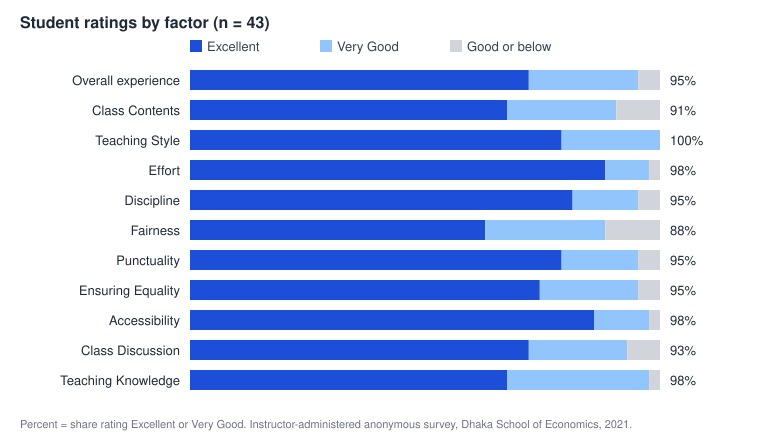

# Teaching Evaluations: Muhammad Taky Tahmid

Student feedback from my lectureship at the **Dhaka School of Economics, University of Dhaka** (2021).

**Courses:** Principles of Macroeconomics · Mathematical Methods for Economics · GIS for Economists
**Responses:** 43 (anonymous, instructor-administered survey)

> This was my own anonymous survey, not an official University of Dhaka institutional evaluation.

## Headline results

| | Share |
|---|---|
| Rated the overall class experience Excellent or Very Good | **95%** (41 of 43) |
| Rated teaching style Excellent or Very Good | **100%** (43 of 43) |
| Understood the lectures | **98%** (42 of 43) |
| Think I should continue teaching | **91%** (39 of 43) |

## Ratings by factor

Share rating each factor *Excellent* or *Very Good* (n = 43).

| Factor | Excellent | Very Good | Good or below | Excellent + Very Good |
|---|---:|---:|---:|---:|
| Overall experience | 31 | 10 | 2 | 95.3% |
| Teaching style | 34 | 9 | 0 | 100.0% |
| Effort | 38 | 4 | 1 | 97.7% |
| Accessibility to students | 37 | 5 | 1 | 97.7% |
| Teaching knowledge | 29 | 13 | 1 | 97.7% |
| Discipline | 35 | 6 | 2 | 95.3% |
| Punctuality | 34 | 7 | 2 | 95.3% |
| Ensuring equality | 32 | 9 | 2 | 95.3% |
| Class discussion | 31 | 9 | 3 | 93.0% |
| Class contents | 29 | 10 | 4 | 90.7% |
| Fairness | 27 | 11 | 5 | 88.4% |

## Selected student comments

Lightly edited for punctuation and capitalization.

- "The video lectures are well prepared. Using pens of different colors was helpful and is highly appreciated."
- "Your dedication is beyond our expectations, and we are more than impressed with your dedicated and innovative teaching style."
- "The class was very interactive."
- "Personally, I enjoyed your class and could understand the topics easily. I would be glad if you taught our class again."
- "Your communication and interpersonal skills are great."

## Files

- [`Teaching_Evaluation_Summary.pdf`](Teaching_Evaluation_Summary.pdf): one-page summary
- [`data/ratings_anonymized.csv`](data/ratings_anonymized.csv): rating responses only, one row per respondent
- [Complete response sheet (Google Sheets, view only)](https://docs.google.com/spreadsheets/d/1kkZm5Wym8kDLN1Ui-R4GWC_Ll73rPVWajwHIJB8UHyw/edit?usp=sharing): all 43 anonymous responses, including written comments

## Contact

[takyurp09.github.io](https://takyurp09.github.io) · [github.com/takyurp09](https://github.com/takyurp09)
